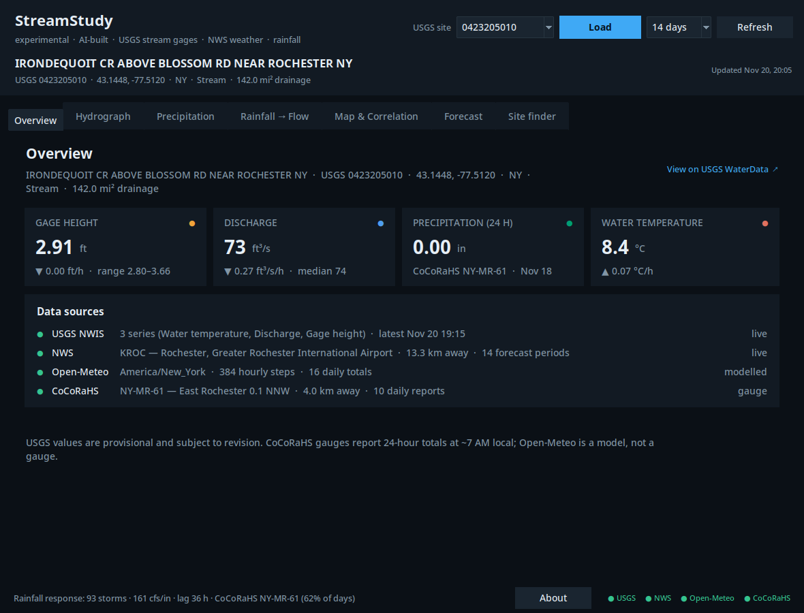
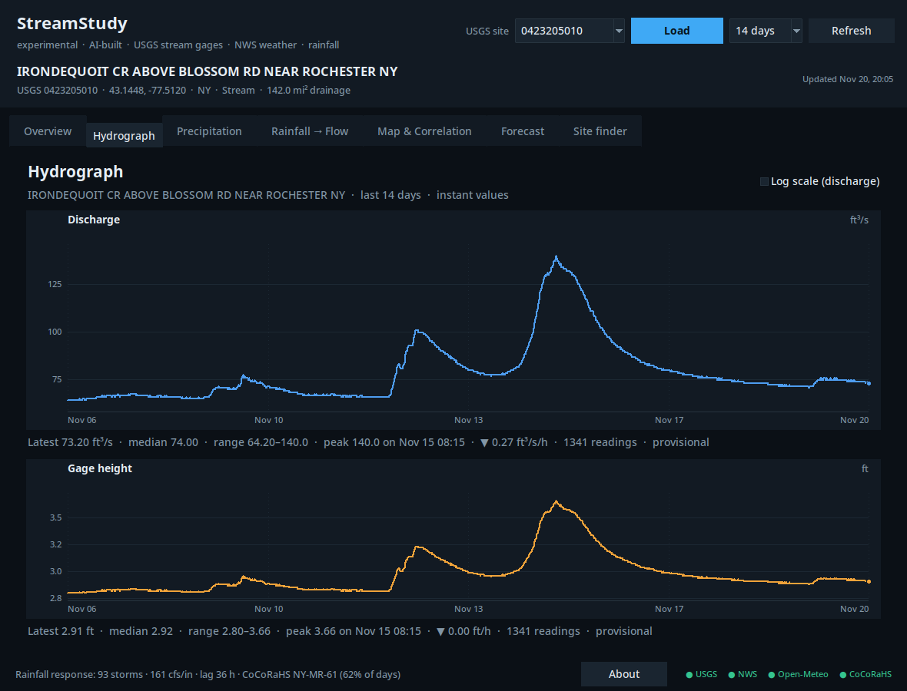
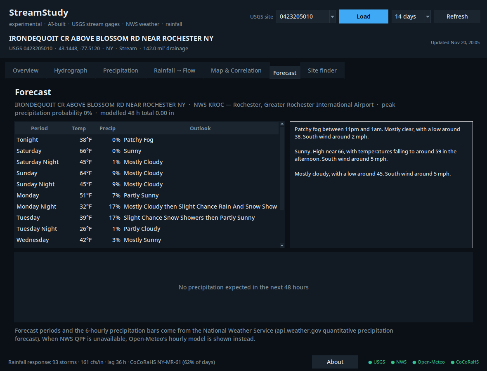
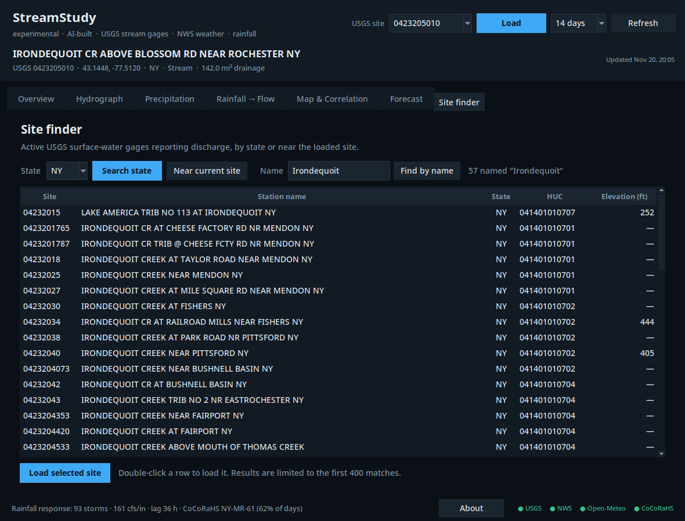

# StreamStudy

> [!WARNING]
> **Experimental — made for playing around, not for decisions.**
> StreamStudy is a hobby project for exploring public USGS, NWS, Open-Meteo and CoCoRaHS APIs.
> The rainfall→flow estimate and the cross-correlations are first-order heuristics, not hydrologic
> forecasts. Do not use this app for flood safety, emergency planning, engineering, insurance, or
> any decision where being wrong matters. All data remain provisional and the source agencies
> remain authoritative. Expect rough edges and breaking API changes.
>
> Built by prompting: **DeepSeek V4.1 Flash** running in **LM Studio Bionic** (LM Studio's
> agentic coding harness) wrote the implementation; a human supplied the requirements and reviews.

An experimental desktop explorer for **USGS stream gages, National Weather Service forecasts, and
precipitation data** — built with Python and Tkinter, with no third-party dependencies.

Enter any USGS site number (the default is [0423205010, Irondequoit Creek above Blossom Rd near
Rochester, NY](https://waterdata.usgs.gov/monitoring-location/USGS-0423205010/)) to see the
hydrograph, nearby gauge rain reports, the official forecast, and — the interesting part — how
**past storms moved this stream**, plus a first-order estimate of what the forecast rain would do.
A clickable regional map adds **cross-correlation between neighbouring streams and the rain that
feeds them**.

| Overview | Hydrograph |
| --- | --- |
|  |  |

| Precipitation | Rainfall → Flow |
| --- | --- |
|  |  |

| Forecast | Site finder |
| --- | --- |
|  |  |


## Features

- **Hydrograph** — discharge and gage height from USGS instantaneous values, with a log-scale
  option, peak/median statistics and a hover readout on every chart
- **Precipitation comparison** — daily bars and a table comparing up to four sources:
  on-site USGS precipitation (parameter `00045` where available), the nearest CoCoRaHS volunteer
  gauge, Open-Meteo's gridded model, and NWS ASOS observations
- **Rainfall → Flow** — 2–10 years of daily flow and rain become a fitted rainfall-runoff
  response: storms detected, response rate (cfs per inch), time to peak, recession half-life,
  a rainfall-vs-rise scatter with the storm examples behind the fit, and a forecast-driven
  predicted hydrograph with a 10–90 % band and the most similar past storms
- **Map & Correlation** — a navigable OpenStreetMap view: **drag to pan, scroll to zoom**, filter
  gages by name, and click any dot to load it (gages and tiles reload for the selected area).
  It pairs up to six regional streams by lagged log-flow correlation (±5 days) and correlates each
  stream with ERA5, the CoCoRaHS gauge and any on-site USGS rain gauge
- **Forecast** — NWS daily periods with full discussion text, plus the NWS gridpoint
  **quantitative precipitation forecast** (6-hourly bars) and peak precipitation probability
- **Site finder** — search active USGS surface-water gages by state, within ~50 km of the
  loaded site, or by **station name** (USGS OGC API), then double-click to load one
- **Resilient by design** — every provider is independent: if one API is down the others still
  render, and the failure is shown as a warning instead of a broken window
- **Fast and polite** — background threads (results marshalled through a queue, never touching Tk
  from a worker), in-memory HTTP cache, one retry on transient 5xx/network errors

## The rainfall → flow model

This is deliberately a **first-order empirical estimate**, not a hydrologic simulation. For each
gage, three to five years of daily data are used:

1. **Baseflow** — a rolling 7-day minimum, lightly smoothed and never above the flow.
2. **Storm events** — consecutive rain days (≥ 0.10 in); the peak is the highest daily flow
   within four days of the storm ending. Measured: rainfall total, rise above baseflow, lag from
   the rain centroid to the peak, and the post-peak recession half-life.
3. **Response fit** — rise per inch through the origin (least squares), plus the 10th/50th/90th
   percentiles of that ratio, the median lag (with its 10–90 % range), a log-log r², and a
   confidence label.
4. **Prediction** — the forecast hyetograph (NWS QPF, or Open-Meteo as fallback) gives a rain
   total and centroid. Peak = baseflow + ratio × rain, timed at centroid + median lag; the curve
   rises smoothly and recesses exponentially at the fitted half-life. The 10–90 % band is drawn
   from the ratio percentiles, and the five most similar historical storms are listed.

You can override the forecast total with any what-if amount in the tab. The model does **not**
account for soil moisture, snowmelt, seasonality, or upstream routing, and it works at daily
resolution — the band is the honest expression of that. Treat it as a screening tool and a way to
see how this particular stream has behaved, not as a flood forecast.

## Regional map and cross-correlation

The **Map & Correlation** tab puts the nearby gages on an OpenStreetMap basemap. It is a real
map view: **drag to pan and scroll to zoom**, and the gage list plus tiles reload for whatever
area you select; **Recenter** returns to the loaded site and the **Filter** box matches station
names or numbers. Click any dot to load that stream. For the current view it then:

- fetches 1–3 years of **daily mean flow** for the six gages nearest the loaded site;
- computes pairwise **log-flow Pearson r at the best lag within ±5 days** — a positive lag means
  the second gage peaks later than the first (downstream travel time, attenuation, or storage);
- correlates each stream's flow with up to three **rain sources**: ERA5 at the map centre, the
  multi-year CoCoRaHS gauge record, and USGS on-site precipitation (`00045`) where a gage reports it;
- shows a signed heatmap, the strongest pairs, and a ranked rain-correlation table.

High correlation at lag 0 means the streams respond together to the same storms. Positive lags
suggest attenuation or routing; weak or negative correlations usually mean regulation (dams,
diversions), different storm tracks, or short/gappy records. The map radius, history length and
recomputation are all interactive.

## Data sources and APIs

Everything comes from documented, structured APIs — no HTML scraping:

| Network | Endpoint | Used for | Auth |
| --- | --- | --- | --- |
| **USGS NWIS** | `waterservices.usgs.gov/nwis/iv/` (JSON) | Recent discharge, gage height, water temperature, on-site precipitation (≤120 days) | none |
| **USGS NWIS** | `waterservices.usgs.gov/nwis/dv/` (JSON) | **Daily mean flow for the multi-year response fit** | none |
| **USGS NWIS** | `waterservices.usgs.gov/nwis/site/` (RDB) | Site metadata and gage search (`siteType=ST`, `parameterCd=00060`) | none |
| **USGS Water Data** | `api.waterdata.usgs.gov/ogcapi/v0/…` | Station **name search** (`monitoring-locations` with a CQL2 `LIKE` filter), plus the newer API generally | none |
| **NWS** | `api.weather.gov/points/…`, `/gridpoints/…`, `/stations/…/observations` | Nearest ASOS observations, daily/hourly forecast, gridpoint QPF | none (User-Agent required) |
| **Open-Meteo** | `api.open-meteo.com/v1/forecast` | Hourly precipitation + probability, daily sums (past 60 days, 2-day forecast) | none |
| **Open-Meteo** | `archive-api.open-meteo.com/v1/archive` | **ERA5 daily precipitation history** (fallback when the gauge record is sparse; regional rain series) | none |
| **OpenStreetMap** | `tile.openstreetmap.org/{z}/{x}/{y}.png` | Basemap tiles for the map tab (6–24 tiles per view, cached in memory) | none; attribution required |
| **CoCoRaHS** | `data.cocorahs.org/cocorahs/export/exportreports.aspx` | Volunteer 24-hour gauge reports: recent comparison, nearest-gauge search, and multi-year history | none |

Notes:

- The historical rain series prefers the **CoCoRaHS gauge** when it covers ≥ 35 % of the period
  (the example gage's gauge covers ~62 % of days), and falls back to **ERA5** otherwise. The tab
  always names the source in use.
- CoCoRaHS also publishes a JSON API at `api2.cocorahs.org`; it resolved IPv6-only and timed out
  from our test network, so the app uses the official bulk CSV export endpoint instead. Both are
  documented public interfaces, not screen-scraping.
- Map tiles are fetched only for the visible view and cached for five minutes. If the tile server
  is unreachable, the map falls back to a schematic grid with the same clickable gage positions.
- USGS values are **provisional** and may be revised. CoCoRaHS gauges report 24-hour totals at the
  observer's reading time (~7 AM local), so daily alignment is approximate. Open-Meteo is a
  gridded model, not a gauge.

## Quick start

Requires Python **3.10+** with Tk support (on Debian/Ubuntu: `sudo apt install python3-tk`).

```bash
git clone git@github.com:llascari/RFD_LL_StreamStudy.git
cd RFD_LL_StreamStudy
python -m streamstudy
```

Command line options:

```bash
python -m streamstudy --site 0423205010 --days 14
python -m streamstudy --help
```

Editable install (adds a `streamstudy` command):

```bash
python -m pip install -e .
streamstudy --site 0423205010
```

Settings (recent sites, last site, window, history length) live in a small JSON file:

| Platform | Path |
| --- | --- |
| Linux | `~/.config/streamstudy/settings.json` (respects `XDG_CONFIG_HOME`) |
| macOS | `~/Library/Application Support/streamstudy/settings.json` |
| Windows | `%APPDATA%\streamstudy\settings.json` |

Override with `--settings PATH` or `$STREAMSTUDY_SETTINGS`.

## How it works

```
provider API ──► parse_*() ──► models (Site, Series, FlowEvent, ResponseFit…)
                                   │
                        BundleLoader
             .load()        — current conditions, all four sources
             .load_history()— multi-year daily flow + rain, then response fit
                                   │
                StreamStudyApp (worker thread → queue → Tk main thread)
                                   │
  HomeView · HydroView · PrecipView · ResponseView · ForecastView · SitesView
```

- **`providers/`** — one module per network. Parsing functions are pure and unit tested against
  recorded API responses (`tests/fixtures/`).
- **`loader.py`** — assembles a `DataBundle` (and the separate historical `HistoryBundle`);
  partial failures are collected in `errors` rather than aborting.
- **`response.py`** — baseflow separation, storm detection, response fit, scenario building and
  hydrograph prediction. Pure functions, no I/O, heavily unit tested.
- **`analysis.py`** — daily aggregation, unit conversions, medians/trends, "nice" axis steps.
- **`ui/charts.py`** — canvas chart widgets (time series lines/bars, log axis, hover readout,
  and a scatter plot with fitted line) so the app stays dependency-free.
- **`ui/theme.py`** — dark ttk theme; `ui/widgets.py` — stat cards and table helpers.

## Project layout

```
RFD_LL_StreamStudy/
├── streamstudy/
│   ├── __main__.py        # argparse entry point
│   ├── app.py             # window, header, background loading, history orchestration
│   ├── loader.py          # per-source fetch orchestration + history analysis
│   ├── models.py          # Site, Series, FlowEvent, ResponseFit, DataBundle…
│   ├── response.py        # rainfall-runoff model: baseflow, storms, fit, prediction
│   ├── correlation.py     # lagged cross-correlation of regional flows and rain
│   ├── analysis.py        # aggregation and formatting helpers
│   ├── http.py            # cached, retrying urllib client
│   ├── settings.py        # JSON settings (recent sites, window, history years)
│   ├── providers/         # usgs.py · nws.py · openmeteo.py · cocorahs.py
│   └── ui/                # theme, charts, widgets and the seven views (incl. map_view)
├── tests/
│   ├── fixtures/          # trimmed real API responses
│   └── test_*.py          # 95 tests (providers, models, correlation, map, name search, Tk smoke)
├── docs/                  # screenshots
├── pyproject.toml
└── .github/workflows/ci.yml
```

## Tests

```bash
python -m unittest discover -s tests -t . -v
```

Headless Linux (runs the Tk smoke tests too):

```bash
xvfb-run -a python -m unittest discover -s tests -t . -v
```

The GUI tests skip themselves automatically when no display is available, so the suite also runs
in plain CI containers. Provider fixtures were captured from the live APIs and trimmed; the
response model is tested on synthetic storm series where the true response (150 cfs/in, 24 h lag,
1.5-day half-life) is known.

## Credits and how this was made

**Human-prompted, LLM-implemented.** The idea, requirements, reviews and corrections came from
the human maintainer. Essentially all of the code, tests, documentation, CI configuration and
screenshots were written by an LLM — **DeepSeek V4.1 Flash** running in **LM Studio Bionic**,
the agentic coding harness of the [LM Studio](https://lmstudio.ai/) desktop app. The in-app
**About** button shows the same note. See [CREDITS.md](CREDITS.md) for the per-area log.

## Attribution

Data courtesy of the [USGS National Water Information System](https://waterservices.usgs.gov/),
the [National Weather Service](https://www.weather.gov/documentation/services-web-api),
[Open-Meteo](https://open-meteo.com/) (CC BY 4.0), and
[CoCoRaHS](https://www.cocorahs.org/) (CC BY 4.0). Map tiles by
[OpenStreetMap contributors](https://www.openstreetmap.org/copyright) (ODbL).

## Project status

**Experimental.** This exists to make public hydrology and weather data fun to poke at — clicking
around streams, seeing how storms move them, and comparing gauges with models. It is not
maintained as a product, has no support guarantees, and the models are deliberately simple.
Issues and pull requests are welcome, but treat everything here as a sandbox.

## License

MIT — see [LICENSE](LICENSE).
