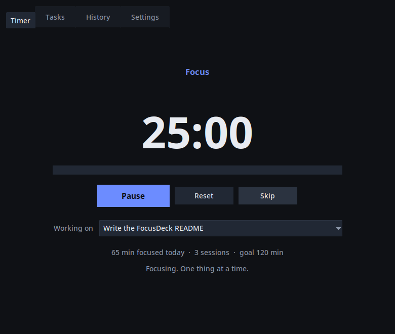
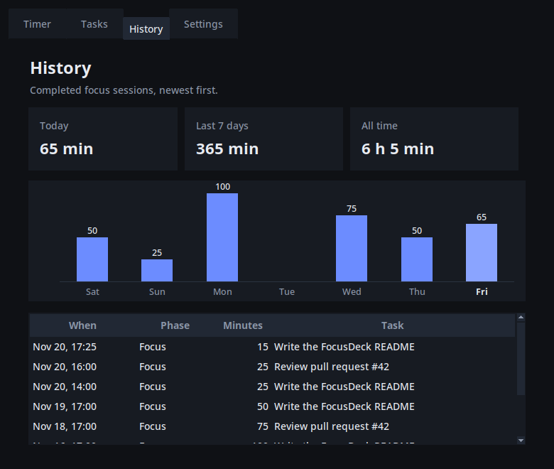

# FocusDeck

A small, dependency-free **Pomodoro-style focus timer** for the desktop, built with Python and Tkinter.

Work in focused blocks, take real breaks, keep a lightweight task list, and watch your focus time add up over the week.

| Timer | History |
| --- | --- |
|  |  |

## Features

- **Focus / short break / long break cycle** with configurable lengths and a long break every *N* sessions
- **Task list** stored in SQLite — attach the task you are working on to each session
- **History tab** with today's totals, a 7-day bar chart, your daily goal line, and every logged session
- **Settings** persist between runs (timer lengths, auto-start behaviour, daily goal)
- **Keyboard shortcuts**: `Space` start/pause, `Ctrl+N` new task, `Ctrl+,` settings
- **Zero third-party dependencies** — only the Python standard library (`tkinter`, `sqlite3`)
- Pure-Tk views are tested headlessly, so the whole app can be smoke-tested in CI

## Requirements

- Python **3.10+** with Tk support
- Linux: install the Tk bindings if your distro splits them out, e.g. `sudo apt install python3-tk`

## Quick start

```bash
git clone git@github.com:llascari/focusdeck.git
cd focusdeck
python -m focusdeck
```

Optional editable install (adds a `focusdeck` command):

```bash
python -m pip install -e .
focusdeck
```

### Where your data lives

| Platform | Default database |
| --- | --- |
| Linux | `~/.local/share/focusdeck/focusdeck.db` (respects `XDG_DATA_HOME`) |
| macOS | `~/Library/Application Support/focusdeck/focusdeck.db` |
| Windows | `%APPDATA%\focusdeck\focusdeck.db` |

Override it with `--db PATH` or the `FOCUSDECK_DB` environment variable:

```bash
python -m focusdeck --db ./focusdeck-demo.db
```

The location is also shown in the Settings tab.

## How it works

The timer is a small state machine. `PomodoroEngine.advance(seconds)` consumes
time, returns any phases that finished, and spills leftover time into the next
phase when auto-start is enabled — so the clock stays accurate even if the UI
ticks slightly late.

Only *completed focus* phases are logged; skipping a phase or resetting the
timer does not pollute your history.

## Project layout

```
focusdeck/
├── focusdeck/
│   ├── __main__.py        # python -m focusdeck entry point (argparse)
│   ├── app.py             # window shell + controller
│   ├── engine.py          # pure Pomodoro state machine and Settings
│   ├── store.py           # SQLite persistence (tasks, sessions, settings)
│   └── ui/
│       ├── theme.py       # dark ttk theme
│       ├── timer_view.py  # clock, controls, active task
│       ├── tasks_view.py  # task list
│       ├── history_view.py# stats, 7-day chart, session table
│       └── settings_view.py
├── tests/
│   ├── test_engine.py     # state machine unit tests
│   ├── test_store.py      # persistence tests (temp-file database)
│   └── test_app_smoke.py  # headless Tk smoke tests
├── pyproject.toml
└── .github/workflows/ci.yml
```

## Tests

```bash
python -m unittest discover -s tests -t . -v
```

On a headless Linux box, run the GUI smoke tests under Xvfb:

```bash
xvfb-run -a python -m unittest discover -s tests -t . -v
```

The GUI tests skip themselves automatically when no display is available.

## License

MIT — see [LICENSE](LICENSE).
