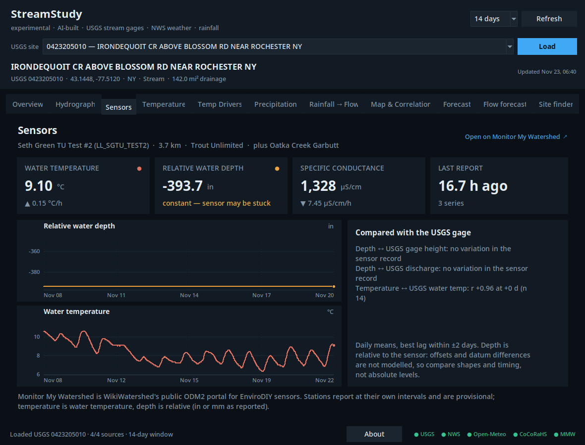
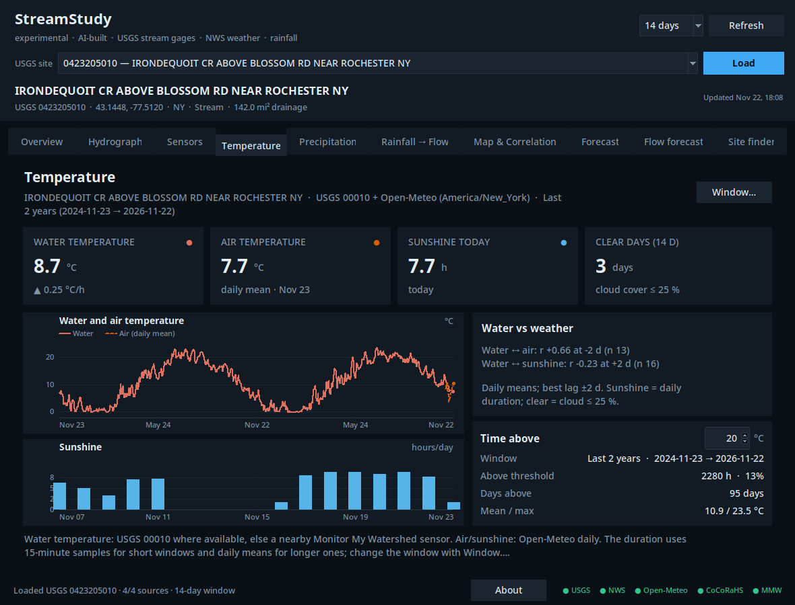
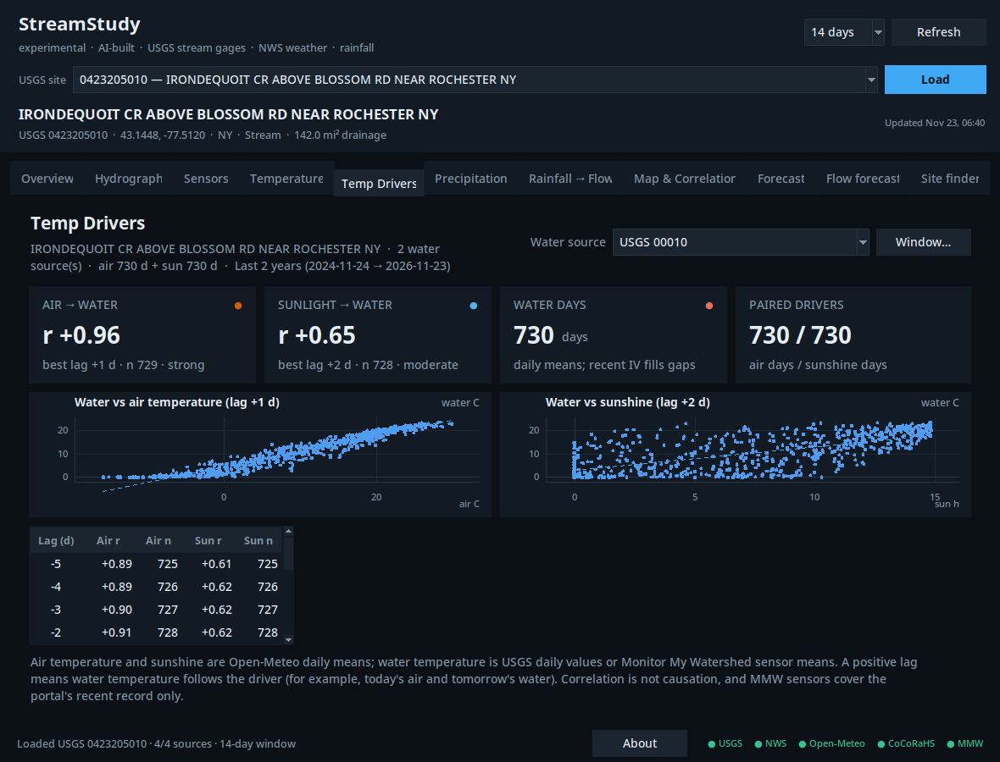
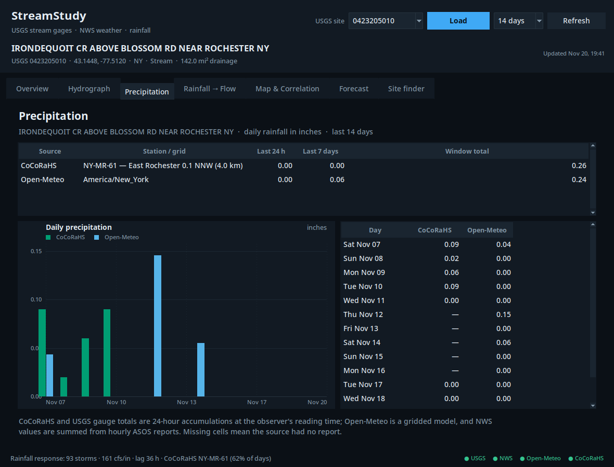
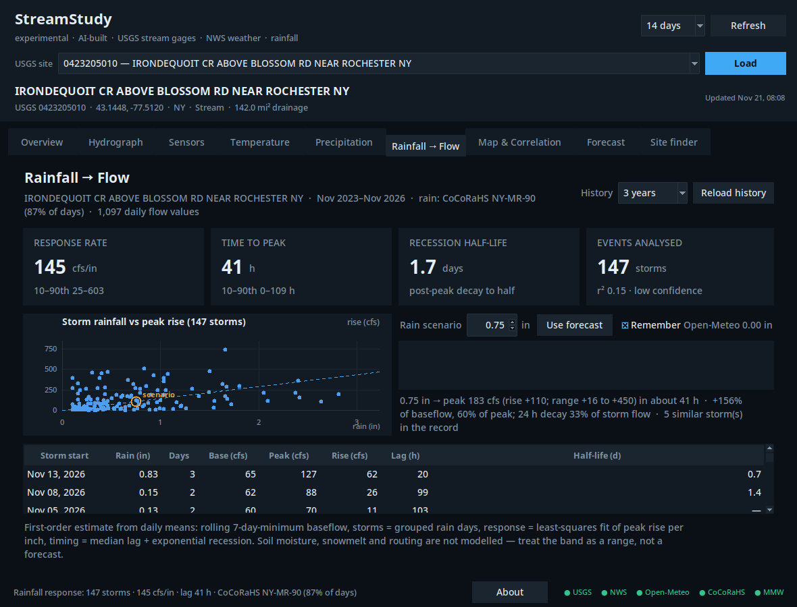
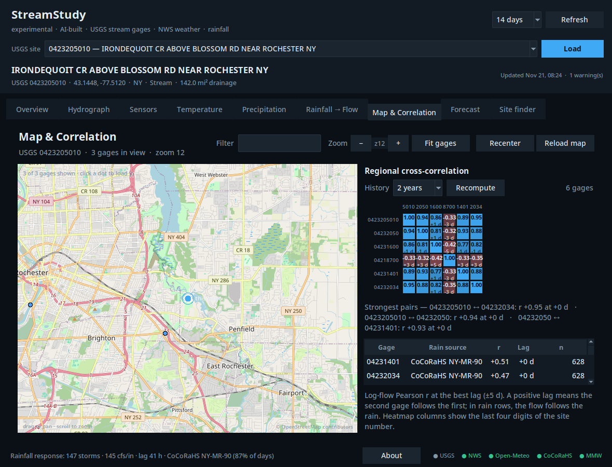
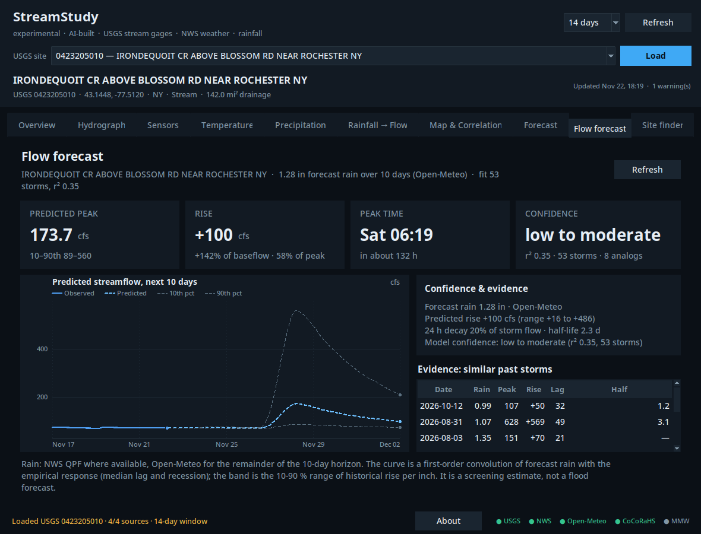
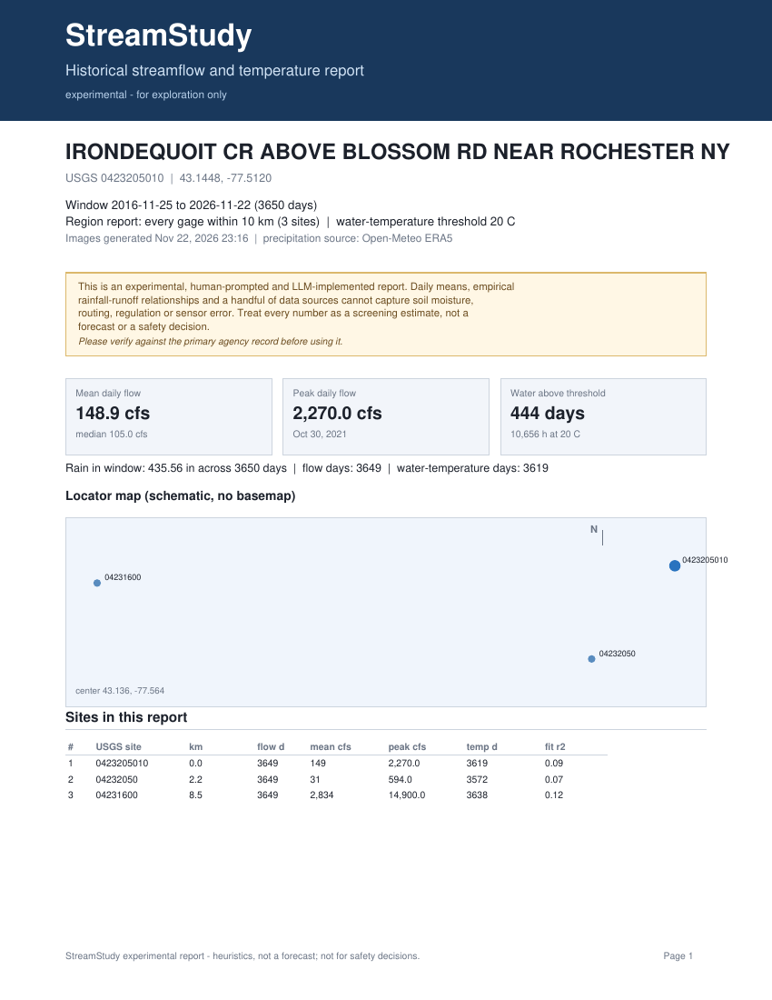

# StreamStudy

> [!WARNING]
> **Experimental — made for playing around, not for decisions.**
> StreamStudy is a hobby project for exploring public USGS, NWS, Open-Meteo and CoCoRaHS APIs.
> The rainfall→flow estimate and the cross-correlations are first-order heuristics, not hydrologic
> forecasts. Do not use this app for flood safety, emergency planning, engineering, insurance, or
> any decision where being wrong matters. All data remain provisional and the source agencies
> remain authoritative. Expect rough edges and breaking API changes.
>
> Built by prompting: **DeepSeek V4.1 Flash** running in **LM Studio Bionic** (LM Studio's
> agentic coding harness) wrote the implementation; a human supplied the requirements and reviews.

An experimental desktop explorer for **USGS stream gages, National Weather Service forecasts, and
precipitation data** — built with Python and Tkinter, with no third-party dependencies.

Enter any USGS site number (the default is [0423205010, Irondequoit Creek above Blossom Rd near
Rochester, NY](https://waterdata.usgs.gov/monitoring-location/USGS-0423205010/)) to see the
hydrograph, nearby gauge rain reports, the official forecast, and — the interesting part — how
**past storms moved this stream**, plus a first-order estimate of what the forecast rain would do.
A clickable regional map adds **cross-correlation between neighbouring streams and the rain that
feeds them**.

| Overview | Hydrograph |
| --- | --- |
|  |  |

| Sensors | Temperature |
| --- | --- |
|  |  |

| Temp Drivers | Precipitation |
| --- | --- |
|  |  |

| Rainfall → Flow | Forecast |
| --- | --- |
|  |  |

| Map & Correlation | Flow forecast (10 days) |
| --- | --- |
|  |  |


| Historical PDF report |
| --- |
|  |

## Features

- **Hydrograph** — discharge and gage height from USGS instantaneous values, with a log-scale
  option, peak/median statistics and a hover readout on every chart
- **Sensors** — nearby **Monitor My Watershed / EnviroDIY** stations (within 60 km, merging up to
  two stations): water temperature, **relative** water depth and conductance, with charts and
  daily-mean correlations against the USGS gage
- **Temperature** — water vs air temperature, daily sunshine and clear-day counts, water↔air and
  water↔sunshine correlations, and **time above a settable threshold** for a **selectable analysis
  window** (24 h / 7 d / 30 d / 90 d / 1 y / 2 y / 5 y / 10 y or custom dates)
- **Temp Drivers** — for gages with water temperature (USGS **or Monitor My Watershed**),
  correlate daily water temperature with **air temperature** and **sunshine** at lags from −5 to
  +5 days: best r/lag, paired-day counts, signed scatter plots with regression lines, and the full
  lag table. A positive lag means water follows the driver. The same analysis is in the PDF report.
- **Precipitation comparison** — daily bars and a table comparing up to four sources:
  on-site USGS precipitation (parameter `00045` where available), the nearest CoCoRaHS volunteer
  gauge, Open-Meteo's gridded model, and NWS ASOS observations
- **Rainfall → Flow** — 2–10 years of daily flow and rain become a fitted rainfall-runoff
  response: storms detected, response rate (cfs per inch), time to peak, recession half-life,
  a rainfall-vs-rise scatter with the storm examples behind the fit (all fitted inside the shared
  analysis window), and a forecast-driven
  predicted hydrograph with a 10–90 % band, the most similar past storms, and an always-visible
  **metrics strip** (rise as % of baseflow/peak, 24 h decay as % of storm flow) with a **Metrics…** dialog
- **Map & Correlation** — a navigable OpenStreetMap view: **drag to pan, scroll to zoom**, and
  **automatic reload on window resize**; **Recenter** keeps your zoom, **Fit gages** auto-frames
  the visible stations, filter gages by name, and click any dot to load it.
  It pairs up to six regional streams by lagged log-flow correlation (±5 days) and correlates each
  stream with ERA5, the CoCoRaHS gauge and any on-site USGS rain gauge
- **Forecast** — NWS daily periods with full discussion text, plus the NWS gridpoint
  **quantitative precipitation forecast** (6-hourly bars) and peak precipitation probability
- **Flow forecast** — a 10-day predicted hydrograph built from forecast rain (NWS QPF first,
  Open-Meteo for the rest of the horizon), the fitted lag/recession, a 10–90 % band from the
  historical rise-per-inch ratios, a confidence assessment, and a table of comparable past storms
- **Historical PDF reports** — **File → Generate PDF report…** writes a multi-page report for the
  loaded creek or every creek within a chosen radius (up to 12 sites), using up to **10 years** of
  daily flow and temperature: hydrographs, rainfall, temperature statistics and threshold duration,
  air/sunshine-to-water correlations for USGS and MMW sensors, highest/lowest flow days, storm
  evidence, a schematic locator map, sources and limitations.
  Long region jobs run in the background with per-site retries, a live progress bar, an elapsed
  timer and current-stage message, a stall hint and a Cancel button. See **[docs/REPORTS.md](docs/REPORTS.md)**.
- **Site finder** — search active USGS surface-water gages by state, within ~50 km of the
  loaded site, or by **station name** (USGS OGC API); **Rank by data value** scores nearby gages
  (model fit, peer correlation, water temperature, proximity) and suggests a central hub
- **Resilient by design** — every provider is independent: if one API is down the others still
  render, and the failure is shown as a warning instead of a broken window
- **Fast and polite** — background threads (results marshalled through a queue, never touching Tk
  from a worker), in-memory HTTP cache, one retry on transient 5xx/network errors
- **Update aware** — checks GitHub on launch (git commit or `VERSION`), shows a footer notice with
  copyable update commands, and documents updating, reverting and forking

## The rainfall → flow model

This is deliberately a **first-order empirical estimate**, not a hydrologic simulation. For each
gage, three to five years of daily data are used:

1. **Baseflow** — a rolling 7-day minimum, lightly smoothed and never above the flow.
2. **Storm events** — consecutive rain days (≥ 0.10 in); the peak is the highest daily flow
   within four days of the storm ending. Measured: rainfall total, rise above baseflow, lag from
   the rain centroid to the peak, and the post-peak recession half-life.
3. **Response fit** — rise per inch through the origin (least squares), plus the 10th/50th/90th
   percentiles of that ratio, the median lag (with its 10–90 % range), a log-log r², and a
   confidence label.
4. **Prediction** — the forecast hyetograph (NWS QPF, or Open-Meteo as fallback) gives a rain
   total and centroid. Peak = baseflow + ratio × rain, timed at centroid + median lag; the curve
   rises smoothly and recesses exponentially at the fitted half-life. The 10–90 % band is drawn
   from the ratio percentiles, and the five most similar historical storms are listed.

You can override the forecast total with any what-if amount in the tab. The model does **not**
account for soil moisture, snowmelt, seasonality, or upstream routing, and it works at daily
resolution — the band is the honest expression of that. Treat it as a screening tool and a way to
see how this particular stream has behaved, not as a flood forecast.

## 10-day flow forecast

The **Flow forecast** tab answers the practical question: *if the forecast rain arrives, when
would this creek rise, how high, and how fast would it fall?*

1. Build a 10-day rain hyetograph, preferring **NWS QPF** and filling the remainder of the horizon
   with **Open-Meteo** hourly precipitation.
2. Convolve each rain increment with the empirical response shape from the historical fit: a
   smooth rise peaking at the median lag, then an exponential recession at the fitted half-life.
3. Draw the 10th/50th/90th percentile curves from the historical rise-per-inch ratios, so the band
   reflects how variable this particular stream has been.
4. Show a confidence label (from r² and storm count), the predicted rise as a percentage of
   baseflow and of peak storm flow, the 24 h decay, and a table of the most similar past storms.

The horizon is capped at 10 days because that is roughly where public weather forecasts stop
being useful. The band is wide when the history is noisy, and that is the point: it is a screening
estimate, not a flood forecast.

## Water temperature drivers

The **Temp Drivers** tab asks a narrower question than the flow model: *how strongly does water
temperature track the weather?* It works for any gage with water temperature — USGS daily values
or a nearby **Monitor My Watershed** sensor — and pairs it with Open-Meteo daily **air temperature**
and **sunshine**. For lags from −5 to +5 days it reports Pearson r, the best absolute lag, the
number of paired days, and a blunt confidence label. Two signed scatter plots show the relationship
with a least-squares line, and the table lists every lag.

A **positive lag means water follows the driver**: today's air paired with tomorrow's water is
+1 day. Air usually leads by zero to two days; sunshine can lead by more because the stream
integrates heat over time. MMW sensors only expose the portal's recent record, so their correlation
is a short-window view; USGS daily values can cover the full 10-year analysis window. Correlation
is not causation, and the weather drivers are gridded model estimates rather than on-site gauges.

### Rise over normal

Absolute temperature correlations mostly answer "is summer warm?". Switch the tab's **Basis** to
**Rise over normal** and every series is reduced to its departure from a centred 15-day rolling
mean before fitting. The cards then show the **slope**: how many °C of water rise accompany each
°C (or sunshine-hour) of driver rise above normal, which is the day-to-day driver signal rather
than the seasonal cycle. Short windows have little room between the rolling normal and the data,
so treat anomaly results there as screening only.

### Sun vs air, all else equal

Sunshine and air temperature travel together, so a plain correlation cannot tell you which one
is doing the driving. Below the cards, the **driver split** regresses water-temperature anomalies
on air and sunshine anomalies **jointly** (lag grid 0–5 days for each driver, best R² wins). Each
slope is then one driver's effect with the other held constant: *sun +1 h → water +x °C, air
constant* and *air +1 °C → water +y °C, sun constant*, each with a partial correlation.

### Compare nearby…

**Compare nearby…** in the Temp Drivers tab asks the cross-stream question: for roughly the same
sun exposure, which creek responds most? It fetches daily water temperature for the nearest USGS
gages — a wide ≈1.5° (≈150 km) net because few gages report water temperature, up to eight
nearest candidates — gives every stream the same joint anomaly regression, and ranks them by the
**held-constant sunshine slope** (°C of water rise per sunshine-hour above normal, air
constant), strongest first, with the partial correlations alongside. Gages without temperature
in the window are listed as such instead of being silently dropped.

## Historical PDF reports

Choose **File → Generate PDF report…** to produce a shareable PDF for the loaded gage. You pick a
preset or custom history window (up to 10 years), the water-temperature threshold, and optionally
a radius; with a radius, every active USGS discharge gage inside it becomes its own section
(maximum 12 sites). The report contains:

- a cover with the site, window, sources, a warning and a schematic locator map;
- a **flow** page: hydrograph with daily rain, distribution, mean/median/min/max, and the highest
  and lowest daily flows with their dates;
- a **temperature** page: daily water (USGS) and air (ERA5) temperatures, threshold line, days and
  hours above the threshold, longest warm run, warmest/coldest days, sunshine, and the fitted
  rainfall-runoff response with the largest storms;
- a **temperature-correlation** page: air/sunshine vs water at lags −5 to +5 days (absolute and
  rise-over-normal), a **driver split** (joint regression: each driver's slope with the other held
  constant), signed scatter plots and a summary for every USGS and Monitor My Watershed water
  source, plus a sunlight-sensitivity ranking of the region's streams when a radius was set;
- a **region** table and one flow + temperature section per nearby creek;
- **sources, methods, health warnings and reproduction steps**.

The PDF writer is ~160 lines of standard-library code (Helvetica, vector charts, no images), so
there is nothing extra to install. Region reports fetch one USGS daily-values request and one
ERA5 request per site; each site gets two retries, failures are listed instead of aborting the run,
and the dialog shows a live elapsed timer, spinner and current stage (USGS, precipitation,
ERA5, fitting, retry, writing), a stall hint after 20 s without new data, and Cancel.

## Regional map and cross-correlation

The **Map & Correlation** tab puts the nearby gages on an OpenStreetMap basemap. It is a real
map view: **drag to pan and scroll to zoom**, the gage list plus tiles reload for whatever area
you select, and **resizing the window** fetches tiles/gages for the newly exposed area. Zoom is
independent of any preset: **− / +** step the level, **Fit gages** frames every visible station,
**Recenter** returns to the loaded site **without resetting your zoom**, and the **Filter** box
matches station names or numbers. Panning moves the map immediately; tiles are cached per zoom
and prefetched ~35 % beyond the viewport, so a slow refresh neither blanks nor snaps the view.
Click any dot to load that stream. For the current view it then:

- fetches 1–3 years of **daily mean flow** for the six gages nearest the loaded site;
- computes pairwise **log-flow Pearson r at the best lag within ±5 days** — a positive lag means
  the second gage peaks later than the first (downstream travel time, attenuation, or storage);
- correlates each stream's flow with up to three **rain sources**: ERA5 at the map centre, the
  multi-year CoCoRaHS gauge record, and USGS on-site precipitation (`00045`) where a gage reports it;
- shows a signed heatmap, the strongest pairs, and a ranked rain-correlation table.

High correlation at lag 0 means the streams respond together to the same storms. Positive lags
suggest attenuation or routing; weak or negative correlations usually mean regulation (dams,
diversions), different storm tracks, or short/gappy records. The map radius, history length and
recomputation are all interactive.

## Data sources and APIs

Everything comes from documented, structured APIs — no HTML scraping:

| Network | Endpoint | Used for | Auth |
| --- | --- | --- | --- |
| **USGS NWIS** | `waterservices.usgs.gov/nwis/iv/` (JSON) | Recent discharge, gage height, water temperature, on-site precipitation (≤120 days) | none |
| **USGS NWIS** | `waterservices.usgs.gov/nwis/dv/` (JSON) | **Daily mean flow** for the response fit and **1 year of daily water temperature** for duration stats | none |
| **USGS NWIS** | `waterservices.usgs.gov/nwis/site/` (RDB) | Site metadata and gage search (`siteType=ST`, `parameterCd=00060`) | none |
| **USGS Water Data** | `api.waterdata.usgs.gov/ogcapi/v0/…` | Station **name search** (`monitoring-locations` with a CQL2 `LIKE` filter), plus the newer API generally | none |
| **NWS** | `api.weather.gov/points/…`, `/gridpoints/…`, `/stations/…/observations` | Nearest ASOS observations, daily/hourly forecast, gridpoint QPF | none (User-Agent required) |
| **Open-Meteo** | `api.open-meteo.com/v1/forecast` | Hourly precipitation + probability; **daily air temperature, sunshine duration, cloud cover and radiation** | none |
| **Open-Meteo** | `archive-api.open-meteo.com/v1/archive` | **ERA5 daily precipitation history** (fallback when the gauge record is sparse; regional rain series) plus **daily air temperature and sunshine** for historical reports | none |
| **OpenStreetMap** | `tile.openstreetmap.org/{z}/{x}/{y}.png` | Basemap tiles for the map tab (6–24 tiles per view, cached in memory) | none; attribution required |
| **CoCoRaHS** | `data.cocorahs.org/cocorahs/export/exportreports.aspx` | Volunteer 24-hour gauge reports: recent comparison, nearest-gauge search, and multi-year history | none |
| **Monitor My Watershed** | `monitormywatershed.org/browse/` (site JSON) + `/dataloader/ajax/` (ODM2 result series) | Nearby EnviroDIY sensors: water temperature, **relative** water depth, conductance | none |

Notes:

- The historical rain series prefers the **CoCoRaHS gauge** when it covers ≥ 35 % of the period
  (the example gage's gauge covers ~62 % of days), and falls back to **ERA5** otherwise. The tab
  always names the source in use.
- CoCoRaHS also publishes a JSON API at `api2.cocorahs.org`; it resolved IPv6-only and timed out
  from our test network, so the app uses the official bulk CSV export endpoint instead. Both are
  documented public interfaces, not screen-scraping.
- Monitor My Watershed sensors report at their own intervals; depth is **relative to the sensor**
  (no surveyed datum) and there is no flow, so the Sensors tab compares shapes/timing with the
  USGS gage rather than absolute levels. A flat series is flagged as a possibly stuck sensor.
- Map tiles are fetched only for the visible view and cached for five minutes. If the tile server
  is unreachable, the map falls back to a schematic grid with the same clickable gage positions.
- USGS values are **provisional** and may be revised. CoCoRaHS gauges report 24-hour totals at the
  observer's reading time (~7 AM local), so daily alignment is approximate. Open-Meteo is a
  gridded model, not a gauge.

## Quick start

**New to Python or Git?** Follow the step-by-step, copy-and-paste guide in
[INSTALL.md](INSTALL.md) — Windows, macOS and Linux, including how to install Python and Tk,
open a terminal, download the project as a ZIP, and fix common errors.

**What you need:** Python 3.10+ with Tk (the official Windows/macOS installers include it), the
project folder, and an internet connection. Git is optional.

### 1. Get the project

- **No Git:** on the GitHub page use **Code → Download ZIP**, then extract it.
- **With Git:**

  ```bash
  git clone https://github.com/llascari/RFD_LL_StreamStudy.git
  cd RFD_LL_StreamStudy
  ```

### 2. Install Python (and Tk)

| Platform | Command / installer |
| --- | --- |
| Windows | [python.org installer](https://www.python.org/downloads/windows/) — tick **Add python.exe to PATH** (or `winget install --id Python.Python.3.12 -e`) |
| macOS | [python.org installer](https://www.python.org/downloads/macos/) (includes Tk), or `brew install python-tk@3.12` |
| Ubuntu / Debian | `sudo apt install -y python3 python3-tk git` |
| Fedora | `sudo dnf install -y python3 python3-tkinter git` |
| Arch | `sudo pacman -S --needed python tk git` |

Verify (expect a Python version and `Tk 8.6`):

```bash
python3 --version
python3 -c "import tkinter; print('Tk', tkinter.TkVersion)"
```

On Windows use `python` instead of `python3`.

### 3. Run it

Open a terminal **in the project folder** that contains `README.md`:

```powershell
# Windows (PowerShell)
cd "$HOME\Documents\RFD_LL_StreamStudy-main"
python -m streamstudy
```

```bash
# macOS / Linux
cd ~/Documents/RFD_LL_StreamStudy-main
python3 -m streamstudy
```

The app opens on USGS `0423205010` (Irondequoit Creek, Rochester NY) and loads conditions,
history, weather, sensors, temperature, map and forecast in the background. Try another gage with `--site`:

```bash
python3 -m streamstudy --site 0423205010 --days 30
```

Command line options:

```bash
python3 -m streamstudy --site 0423205010 --days 14
python3 -m streamstudy --help
```

Editable install (optional; adds a `streamstudy` command):

```bash
python3 -m pip install -e .
streamstudy --site 0423205010
```

Settings (recent sites, last site, window, history length) live in a small JSON file:

| Platform | Path |
| --- | --- |
| Linux | `~/.config/streamstudy/settings.json` (respects `XDG_CONFIG_HOME`) |
| macOS | `~/Library/Application Support/streamstudy/settings.json` |
| Windows | `%APPDATA%\streamstudy\settings.json` |

Additional settings (editable through the UI, stored in the same file):

| Key | Meaning | Default |
| --- | --- | --- |
| `temperature_threshold_c` | duration-above threshold, editable on the Temperature tab | `20` |
| `store_flow_metrics` | remember predicted flow metrics per site (`Remember` in Rainfall → Flow) | `true` |
| `flow_metrics` | last predicted peak/rise/decay percentages per site number (view/save via **Rainfall → Flow → Metrics…** or **Settings → Flow metrics…**) | `{}` |
| `site_names` | number → station-name map used by the picker | `{}` |
| `map_zoom` | last map zoom (4–15) | `10` |
| `analysis_window` | shared window for the flow model and temperature stats: `{"mode": "1y"}` or `{"mode": "custom", "start": "YYYY-MM-DD", "end": "YYYY-MM-DD"}` | `{"mode": "1y"}` |

**Reset:** use **Settings → Reset settings to defaults…** in the menu bar. It clears recent sites,
saved metrics and preferences, and keeps the current site loaded.

Override the file location with `--settings PATH` or `$STREAMSTUDY_SETTINGS`.

## Continuing in Bionic on another machine

Bionic project registration and chat history live under `~/.lmstudio`, not in this repository.
The repo carries a portable context pack instead:

- [docs/BIONIC_CONTEXT.md](docs/BIONIC_CONTEXT.md) — current state, constraints, architecture,
  data-source traps and recent work.
- [docs/BIONIC_PROMPT.md](docs/BIONIC_PROMPT.md) — paste-ready prompt for a fresh Bionic chat.

Open this folder as a project on the other machine, start a chat, paste that prompt, and the agent
will read `AGENTS.md` plus the context pack before touching code. This is safer than copying the
local LM Studio database, which contains chat history and machine-specific paths.

## Updating, reverting and forking

The app checks GitHub once after launch and shows **“Update available (commit …)”** in the footer
when a newer version exists; click it or use **Help → Check for updates…** for copyable commands.

- **Update**: `git pull` in a clone, or download/replace the ZIP — settings are kept
- **Revert**: `git log --oneline`, then `git checkout <commit>`; or download
  `…/archive/<commit>.zip`
- **Fork**: fork on GitHub, change `APP_NAME` and `REPO` in `streamstudy/updates.py`, keep the
  MIT license, attribution and experimental warning

Full details (including dirty-tree handling and running variants side by side):
**[UPDATING.md](docs/UPDATING.md)**.

## How it works

```
provider API ──► parse_*() ──► models (Site, Series, FlowEvent, ResponseFit…)
                                   │
                        BundleLoader
             .load()        — current conditions, weather, sensors, all sources
             .load_history()— multi-year daily flow + rain, then response fit
                                   │
                StreamStudyApp (worker thread → queue → Tk main thread)
                                   │
  HomeView · HydroView · SensorsView · TemperatureView · ThermalView · PrecipView ·
  ResponseView · MapView · ForecastView · FlowForecastView · SitesView
                                   │
          report.py ──► pdf.py (stdlib PDF writer)
```

- **`providers/`** — one module per network. Parsing functions are pure and unit tested against
  recorded API responses (`tests/fixtures/`).
- **`loader.py`** — assembles a `DataBundle` (and the separate historical `HistoryBundle`);
  partial failures are collected in `errors` rather than aborting.
- **`response.py`** — baseflow separation, storm detection, response fit, scenario building,
  48 h what-if prediction and the 10-day forecast convolution. Pure functions, no I/O, heavily
  unit tested.
- **`report.py` + `pdf.py`** — historical statistics, extreme-day selection and a dependency-free
  multi-page PDF renderer (cover, charts, locator map, per-site pages, references).
- **`analysis.py`** — daily aggregation, unit conversions, medians/trends, "nice" axis steps.
- **`ui/charts.py`** — canvas chart widgets (time series lines/bars, log axis, hover readout,
  and a scatter plot with fitted line) so the app stays dependency-free.
- **`ui/theme.py`** — dark ttk theme; `ui/widgets.py` — stat cards and table helpers.

## Project layout

```
RFD_LL_StreamStudy/
├── streamstudy/
│   ├── __main__.py        # argparse entry point
│   ├── app.py             # window, header, background loading, history orchestration
│   ├── loader.py          # per-source fetch orchestration + history analysis
│   ├── models.py          # Site, Series, FlowEvent, ResponseFit, DataBundle…
│   ├── response.py        # rainfall-runoff model: baseflow, storms, fit, 10-day prediction
│   ├── correlation.py     # lagged cross-correlation of regional flows and rain
│   ├── temperature_stats.py # hours above a threshold, clear-day counts
│   ├── thermal.py         # water vs air/sunshine correlations and lag curves
│   ├── ranking.py         # "best nearby gage" scoring and hub suggestion
│   ├── updates.py         # GitHub commit/VERSION update check
│   ├── analysis_window.py # shared preset/custom analysis window
│   ├── report.py          # historical report statistics + page composition
│   ├── pdf.py             # tiny stdlib PDF 1.4 writer (text, lines, rects, curves)
│   ├── analysis.py        # aggregation and formatting helpers
│   ├── http.py            # cached, retrying urllib client
│   ├── settings.py        # JSON settings (recent sites, analysis window, map)
│   ├── providers/         # usgs · nws · openmeteo · cocorahs · monitormywatershed
│   └── ui/                # theme, charts, widgets, eleven tab views, map_view, report_dialog
├── tests/
│   ├── fixtures/          # trimmed real API responses
│   └── test_*.py          # 181 tests (providers, models, thermal, report/PDF, region loader, Tk)
├── docs/                  # screenshots, HOW_THIS_WAS_MADE.md, REPORTS.md, UPDATING.md
├── INSTALL.md             # beginner-friendly setup for Windows/macOS/Linux
├── VERSION                # human-readable release version used by the update check
├── pyproject.toml
└── .github/workflows/ci.yml
```

## Tests

```bash
python -m unittest discover -s tests -t . -v
```

Headless Linux (runs the Tk smoke tests too):

```bash
xvfb-run -a python -m unittest discover -s tests -t . -v
```

The GUI tests skip themselves automatically when no display is available, so the suite also runs
in plain CI containers. Provider fixtures were captured from the live APIs and trimmed; the
response model is tested on synthetic storm series where the true response (150 cfs/in, 24 h lag,
1.5-day half-life) is known. The forecast convolution is checked for horizon length, band ordering
and analog selection; the PDF is checked for valid header/footer, page count and site text; the
region loader is tested for radius filtering, retries, partial failure, progress and cancellation.

## Credits and how this was made

**Human-prompted, LLM-implemented.** The idea, requirements, reviews and corrections came from
the human maintainer. Essentially all of the code, tests, documentation, CI configuration and
screenshots were written by an LLM — **DeepSeek V4.1 Flash** running in **LM Studio Bionic**,
the agentic coding harness of the [LM Studio](https://lmstudio.ai/) desktop app. The in-app
**About** button shows the same note. See [CREDITS.md](CREDITS.md) for the per-area log, and
**[How this was made](docs/HOW_THIS_WAS_MADE.md)** for the prompt-by-prompt build story, dead ends
and a recipe you can copy.

## Attribution

Data courtesy of the [USGS National Water Information System](https://waterservices.usgs.gov/),
the [National Weather Service](https://www.weather.gov/documentation/services-web-api),
[Open-Meteo](https://open-meteo.com/) (CC BY 4.0),
[CoCoRaHS](https://www.cocorahs.org/) (CC BY 4.0), and
[Monitor My Watershed](https://monitormywatershed.org/) / WikiWatershed / EnviroDIY. Map tiles by
[OpenStreetMap contributors](https://www.openstreetmap.org/copyright) (ODbL).

## Project status

**Experimental.** This exists to make public hydrology and weather data fun to poke at — clicking
around streams, seeing how storms move them, and comparing gauges with models. It is not
maintained as a product, has no support guarantees, and the models are deliberately simple.
Issues and pull requests are welcome, but treat everything here as a sandbox.

## License

MIT — see [LICENSE](LICENSE).
